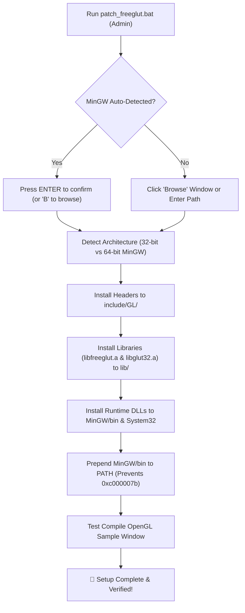

# FreeGLUT & OpenGL 1-Click Auto-Patcher for Code::Blocks (MinGW)

[](LICENSE)
[](https://microsoft.com)
[](#educational-statement)
[](https://www.codeblocks.org)

An automated, beginner-friendly **1-click patcher** that sets up FreeGLUT and OpenGL inside Code::Blocks (MinGW) on Windows. Eliminates missing header errors, linker failures (`-lglut32`), 32-bit/64-bit architecture mismatches, runtime missing DLL dialogs, and `0xc000007b` compiler crashes.

---

## 🚀 Quick Start (1 Click)

1. **Download / Clone** this repository (or download [`FreeGLUT_Patcher.zip`](../FreeGLUT_Patcher.zip)).
2. **Right-click `patch_freeglut.bat`** and select **Run as administrator**.
   *(If you double-click it, Windows UAC will prompt for administrator permission automatically).*
3. **Press <kbd>ENTER</kbd>** to accept your auto-detected Code::Blocks MinGW folder, or type **`B`** to open the graphical folder chooser window.
4. **Done!** Open Code::Blocks and start coding OpenGL immediately.

---

## 🌟 Key Features

- **⚡ 1-Click Setup**: No more manually hunting down directories or copy-pasting headers, `.a` libs, and `.dll`s.
- **📁 Graphical Folder Chooser**: Easily browse and pick your Code::Blocks / MinGW installation through a native Windows folder browser.
- **🧠 Smart Architecture Detection**: Automatically detects whether your MinGW compiler is **64-bit (`x86_64`)** or **32-bit (`x86`)** and installs the matching binaries.
- **🛡️ Fixes `0xc000007b` Compiler Conflicts**: Automatically protects against system `PATH` collisions (such as 32-bit `libwinpthread-1.dll` from Android Platform-Tools / WinGet).
- **🧙 Code::Blocks Wizard Compatible**: Automatically provides dual library aliases (`libfreeglut.a` and `libglut32.a`), so both the built-in GLUT Wizard and standard command-line flags link with zero errors.
- **🌐 System-Wide DLL Installation**: Copies runtime DLLs to `System32` (and `SysWOW64` on 64-bit Windows) so compiled `.exe` files run anywhere without needing DLLs in the local project folder.
- **🧪 Built-in Verification**: Includes `test_freeglut.bat` and sample projects ([`sample_triangle.cpp`](sample/sample_triangle.cpp) and [`sample_cube.cpp`](sample/sample_cube.cpp)) to test your compiler immediately.

---

## 🛠️ How It Works



---

## 📂 Repository Contents

```text
FreeGLUT_Patcher/
│
├── patch_freeglut.bat          # Main 1-click installer and auto-patcher script
├── test_freeglut.bat           # Standalone compiler verification test script
├── README.md                   # Documentation and usage guide
├── README.txt                  # Plaintext instructions for zipped releases
├── LICENSE                     # MIT License & Educational Disclaimer
├── .gitignore                  # Git ignore rules (protects vendor binaries)
│
├── files/                      # Precompiled FreeGLUT binaries organized by bitness
│   ├── select_folder.ps1       # Native Windows folder browser dialog helper
│   ├── include/GL/             # freeglut.h, glut.h, freeglut_ext.h, freeglut_std.h
│   ├── lib/
│   │   ├── x64/                # 64-bit libs: libfreeglut.a, libglut32.a, libglut.a
│   │   └── x86/                # 32-bit libs: libfreeglut.a, libglut32.a, libglut.a
│   └── bin/
│       ├── x64/                # 64-bit runtime DLLs: freeglut.dll, glut32.dll
│       └── x86/                # 32-bit runtime DLLs: freeglut.dll, glut32.dll
│
└── sample/                     # Ready-to-use sample OpenGL projects
    ├── OpenGL_Sample.cbp       # Ready-to-open Code::Blocks project file
    ├── sample_triangle.cpp     # Smooth 2D RGB OpenGL Triangle demo
    └── sample_cube.cpp         # Interactive 3D Rotating Color Cube demo
```

---

## 💡 How to Create an OpenGL Project in Code::Blocks

### Method 1: Using the Ready-to-Open Sample Project (Fastest)
1. Navigate into the `sample/` folder.
2. Double-click [`OpenGL_Sample.cbp`](sample/OpenGL_Sample.cbp).
3. Code::Blocks will open. Press <kbd>F9</kbd> (*Build and run*)!

### Method 2: Creating a New Project via GLUT Wizard
1. In Code::Blocks, click **File** -> **New** -> **Project...**.
2. Select **GLUT project** and click **Go**.
3. When prompted for **GLUT's location**, select your MinGW folder (e.g., `C:\Program Files\CodeBlocks\MinGW`).
4. Finish the wizard and press <kbd>F9</kbd>!

### Method 3: Standard Console Project (Recommended for Coursework)
1. In Code::Blocks, click **File** -> **New** -> **Project...** -> **Console Application**.
2. Choose **C++** (or C), name your project, and click **Finish**.
3. Paste your OpenGL code (or copy [`sample/sample_triangle.cpp`](sample/sample_triangle.cpp)).
4. Go to menu: **Project** -> **Build options...**.
5. In the left tree, click the **root project name** (so settings apply to both *Debug* and *Release*).
6. Under the **Linker settings** tab, in **Link libraries**, click **Add** and add:
   ```text
   freeglut
   opengl32
   glu32
   ```
   *(Note: You can also write `glut32` in place of `freeglut`.)*
7. Click **OK** and press <kbd>F9</kbd>!

---

## 🔍 Common Beginner Issues Solved by This Patcher

| Problem | Root Cause | Patcher Solution |
| :--- | :--- | :--- |
| `fatal error: GL/glut.h: No such file or directory` | MinGW-w64 looks in `<MinGW>\x86_64-w64-mingw32\include`, while older guides state `<MinGW>\include`. | Installs headers to both generic and target-specific include folders. |
| `cannot find -lglut32` | Code::Blocks wizard generates `-lglut32`, but FreeGLUT only names its library `libfreeglut.a`. | Provides duplicate aliases (`libglut32.a` & `libfreeglut.a`), satisfying both. |
| `cc1plus.exe (0xc000007b)` | Incompatible 32-bit `libwinpthread-1.dll` from Android Platform-Tools / WinGet in `PATH`. | Prepends `MinGW\bin` to `PATH` so correct 64-bit MinGW runtime DLLs load first. |
| `freeglut.dll was not found` | The executable cannot locate the dynamic library at runtime. | Installs DLLs to `MinGW\bin` and system-wide (`System32` & `SysWOW64`). |

---

## ⚖️ Educational Statement & License

This project is created strictly for **educational ease, non-profit academic learning, and student assistance**.

- **Non-Profit**: This tool is provided 100% free of charge. No payment or commercial exploitation is permitted or intended.
- **Automation Scripts License**: The scripts, documentation, and configuration files are licensed under the **[MIT License](LICENSE)**.
- **Third-Party Credits & Copyrights**:
  - **FreeGLUT**: Copyright (c) 1999-2000 Pawel W. Olszta. Licensed under the X-Consortium / FreeGLUT License.
  - **MinGW Binaries Packaging**: Compiled by Martin Payne ([Transmission Zero](http://www.transmissionzero.co.uk/)).
  - **Code::Blocks**: Open-source C/C++ IDE licensed under GNU GPLv3.
  - **OpenGL**: Registered trademark of Silicon Graphics, Inc. / Khronos Group.
